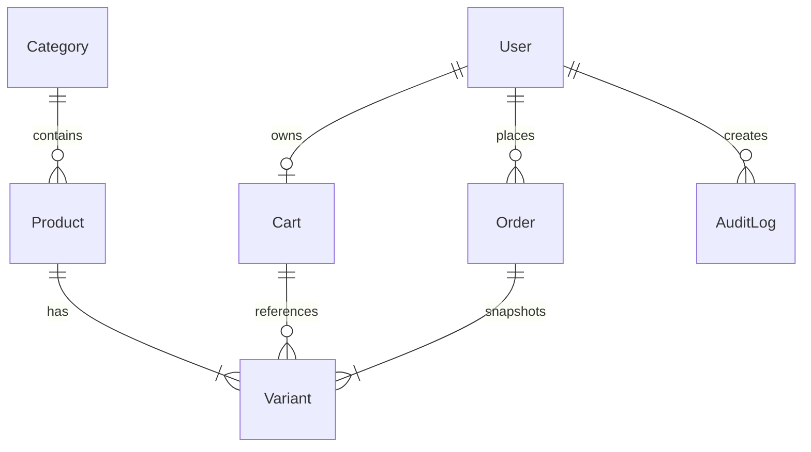

# Database Documentation

## Entity Relationship Diagram

All monetary amounts are stored as whole paise (integers) to prevent floating-point rounding errors.
Currency formatting into INR (₹) is handled solely in the frontend presentation layer.

## Models

### User
| Field | Type | Note |
| --- | --- | --- |
| name | String | Full name of the user |
| email | String | Unique lowercase login email |
| passwordHash | String | Bcrypt hash |
| role | String | 'customer' or 'admin' |
| addresses | Array | Embedded subdocuments (max 10) |

### Category
| Field | Type | Note |
| --- | --- | --- |
| name | String | Category display title |
| slug | String | Unique URL identifier |
| isActive | Boolean | Soft delete flag |

### Product
| Field | Type | Note |
| --- | --- | --- |
| name | String | Product name |
| slug | String | Unique URL slug |
| description | String | Product details text |
| categoryId | ObjectId | Reference to Category |
| imageUrl | String | Image link URL |
| isActive | Boolean | Product visibility flag |

### Variant
| Field | Type | Note |
| --- | --- | --- |
| productId | ObjectId | Reference to Product |
| sku | String | Unique stock keeping unit |
| attributes | Map | Key-value options (e.g. size, color) |
| priceMinor | Integer | Price in whole paise (min 0) |
| stock | Integer | Available inventory count (min 0) |
| isActive | Boolean | Variant availability flag |

### Cart
| Field | Type | Note |
| --- | --- | --- |
| userId | ObjectId | Unique owner of the cart |
| items | Array | Objects containing variantId and quantity |
| couponCode | String | Applied coupon code |

### Coupon
| Field | Type | Note |
| --- | --- | --- |
| code | String | Uppercase unique coupon code |
| type | String | 'percent' or 'fixed' |
| value | Integer | Percent number or minor paise amount |
| minSubtotalMinor | Integer | Minimum cart subtotal in paise |
| expiresAt | Date | Expiration timestamp |
| isActive | Boolean | Coupon active status |

### Order
| Field | Type | Note |
| --- | --- | --- |
| orderNumber | String | Unique human-readable code |
| userId | ObjectId | Buyer reference |
| status | String | Lifecycle enum |
| items | Array | Frozen snapshots of items and prices |
| shippingAddress | Object | Frozen snapshot of delivery address |
| subtotalMinor | Integer | Subtotal in paise |
| discountMinor | Integer | Discount in paise |
| taxMinor | Integer | Tax in paise |
| shippingMinor | Integer | Shipping fee in paise |
| totalMinor | Integer | Final total in paise |
| idempotencyKey | String | Unique key per checkout attempt |
| requestHash | String | SHA-256 hash of checkout body |
| payment | Object | Simulated payment status and attempts |
| statusHistory | Array | Recorded lifecycle events |

### AuditLog
| Field | Type | Note |
| --- | --- | --- |
| actorId | ObjectId | User who initiated action |
| actorRole | String | Role of actor |
| action | String | Event name (e.g. product.create) |
| entityType | String | Target model name |
| entityId | ObjectId | Target record ID |
| before | Object | State prior to modification |
| after | Object | State post modification |
| reason | String | Required note for inventory changes |

## Indexes

- `users.email`: Unique index for fast user authentication.
- `categories.slug`: Unique index for category browsing routes.
- `products.slug`: Unique index for product lookup routes.
- `products.categoryId + products.isActive`: Compound index for category filtering.
- `products.name + products.description`: Text index for text search queries.
- `variants.sku`: Unique index for inventory uniqueness.
- `variants.productId + variants.isActive`: Compound index for product variant loading.
- `carts.userId`: Unique index ensuring one cart per customer.
- `coupons.code`: Unique index for coupon verification.
- `orders.orderNumber`: Unique index for order lookups.
- `orders.userId + orders.idempotencyKey`: Unique compound index enforcing checkout idempotency.
- `orders.status`: Index for admin order filtering.
- `orders.createdAt`: Descending index for sorting order histories and date queries.
- `auditlogs.createdAt`: Index for chronological audit log inspection.
- `auditlogs.entityType`: Index for filtering audit records by model.

