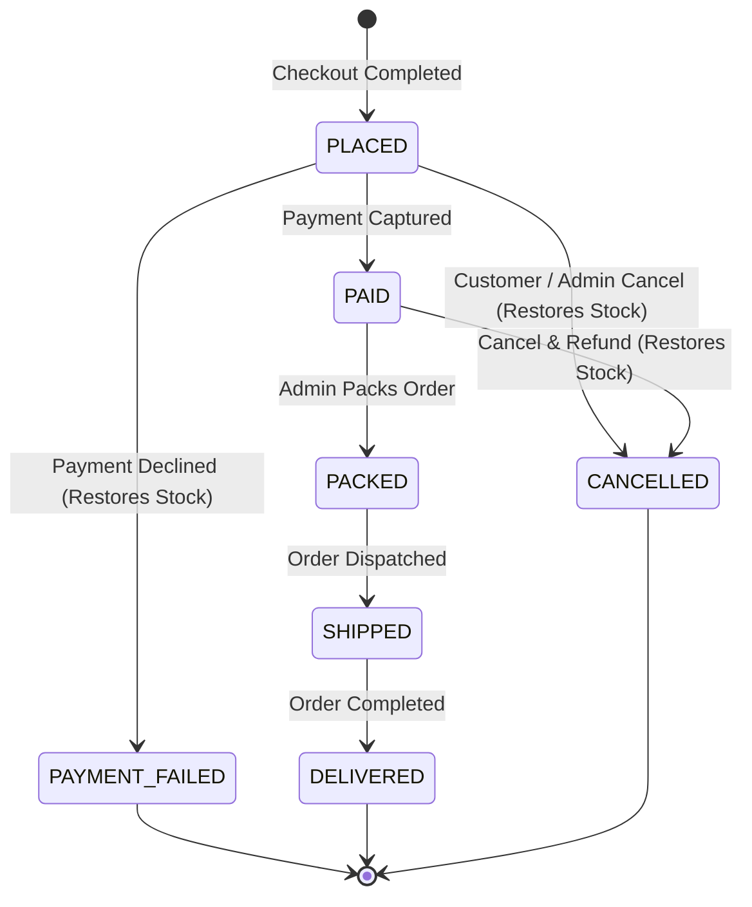

# Order Status Lifecycle

All order transitions are strictly defined in `orderStateMachine.js`. No order state can be changed outside of these rules.

## Transition Matrix

| From State | To State | Initiator | Stock Impact |
| --- | --- | --- | --- |
| PLACED | PAID | Customer (Pay Success) | Stock remains consumed |
| PLACED | PAYMENT_FAILED | Customer (Pay Decline) | Stock is restored to inventory |
| PLACED | CANCELLED | Customer / Admin | Stock is restored to inventory |
| PAID | PACKED | Admin | Stock remains consumed |
| PAID | CANCELLED | Admin / Customer | Stock restored, payment marked refunded_simulated |
| PACKED | SHIPPED | Admin | Stock remains consumed |
| SHIPPED | DELIVERED | Admin | Stock remains consumed |

Terminal states: `PAYMENT_FAILED`, `DELIVERED`, and `CANCELLED`. Once an order enters any of these states, no further transitions are allowed.

## State Diagram

## Why These Rules Exist

Stock must decrement immediately when an order is placed to prevent other shoppers from buying the same item.
If the customer's payment fails or the order is cancelled, stock must be returned in the exact same transaction.
Once an item is packed or shipped, cancellation is blocked to avoid recalling parcels that are already in transit.

